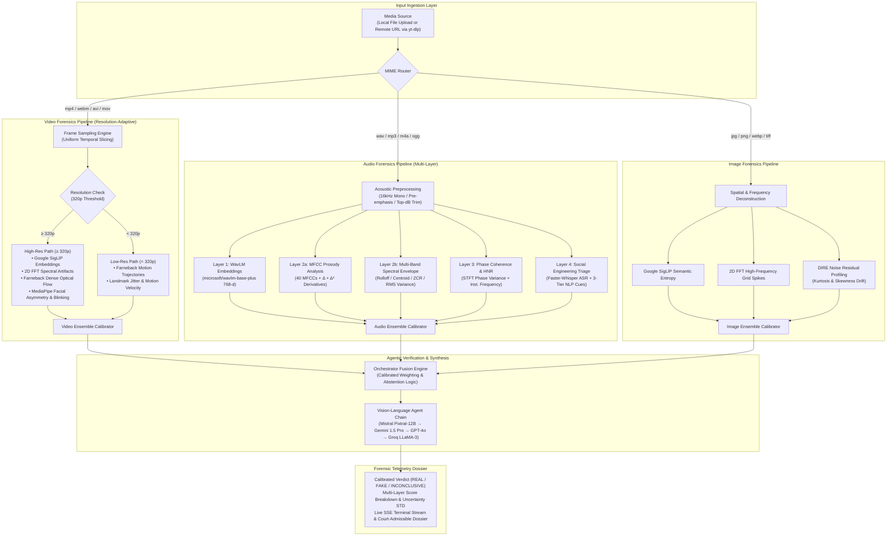

<h2 align="center"><b>deepfake-detection-heuristics</b></h2>

<h4 align="center">Implementation of a multi-modal deep learning and agentic engine for deepfake forensics</h4>

<p align="center">
    <a href="https://github.com/yuvanvishnupandi/deepfake-detection-heuristics"></a>
    <a href="https://schrodinger-app.vercel.app/"></a>
    <a href="LICENSE"></a>
    
    
    
    
    
    
    
</p>

---

Implementation of a multi-modal deep learning forensics framework in PyTorch and FastAPI. The engine couples spectral Fourier analysis, self-blended boundary heuristics, dense optical flow trajectories, WavLM self-supervised representations, phase coherence metrics, and vision-language agents (Pixtral / Gemini) into a unified, resolution-adaptive pipeline with mathematically calibrated abstention.

Capable of analyzing video streams (`mp4`, `webm`, `avi`, `mov`), acoustic waveforms (`wav`, `mp3`, `m4a`, `ogg`), and high-resolution imagery (`jpg`, `png`, `webp`, `tiff`), either via direct file upload or via zero-friction URL extraction using `yt-dlp`.

---

## Architecture



---

## Forensic Heuristic Layers

| Modality | Diagnostic Layer | Research / Physical Foundation | Primary Target |
|:---|:---|:---|:---|
| **Video** | **SigLIP Foundation** | *Zhai et al., 2023* | Semantic inconsistency and temporal patch boundary discontinuities |
| **Video** | **2D FFT Spectral Analysis** | *Frank et al., ICML 2020* | High-frequency grid spikes from transposed convolution upsampling |
| **Video** | **Dense Optical Flow** | *Farneback / Shiohara CVPR 2022* | Unnatural inter-frame motion vector acceleration and boundary warping |
| **Video** | **Facial Asymmetry & Liveness** | *MediaPipe 468-pt Mesh* | Eye blink intervals, abnormal pupillary dynamics, micro-jitter |
| **Audio** | **WavLM Foundation** | *Chen et al., IEEE JSTSP 2022* | 768-dim SSL acoustic embeddings for synthetic speaker manifold deviation |
| **Audio** | **MFCC Naturalness ($\Delta, \Delta^2$)** | *Vocal Tract Acoustic Dynamics* | Static cepstral coefficients indicative of neural auto-regressive TTS |
| **Audio** | **Spectral Envelope** | *HiFi-GAN / WaveGlow Artifacts* | Artificially smooth rolloff trajectories and periodic zero-crossing aliasing |
| **Audio** | **Phase Coherence & HNR** | *Griffin-Lim / Neural Vocoders* | Phase angle variance collapse and harmonic-to-noise ratio degradation |
| **Audio** | **Social Engineering NLP** | *Faster-Whisper + RBI Taxonomy* | Financial extortion, urgent OTP theft, legal coercion, and panic induction |
| **Image** | **DIRE Noise Profiling** | *Wang et al., 2023* | PRNU sensor noise breakdown; unnatural residual kurtosis and skewness |
| **Ensemble**| **Agentic Verification** | *Pixtral-12B / Gemini 1.5 Pro* | Multi-fallback LLM cross-examination of numerical telemetry into legal dossiers |

---

## Install

### Prerequisites

- Python 3.11+
- Node.js 18+ (for frontend)
- FFmpeg (installed and available on system `PATH`)
- CUDA-enabled GPU (optional, automatic CPU fallback supported)

### Setup

```bash
# Clone the repository
$ git clone https://github.com/yuvanvishnupandi/deepfake-detection-heuristics.git
$ cd deepfake-detection-heuristics

# Backend environment setup
$ cd backend
$ python -m venv venv
$ source venv/bin/activate  # On Windows: .\venv\Scripts\activate
$ pip install -r requirements.txt

# Frontend environment setup
$ cd ../frontend
$ npm install
```

### Environment Configuration

Create a `.env` file in `backend/`:

```env
# Database
MONGODB_URL=mongodb+srv://<username>:<password>@cluster.mongodb.net/schrodinger_db

# LLM Providers (Multi-fallback chain: Mistral -> Gemini -> OpenAI -> Groq)
MISTRAL_API_KEY=your_mistral_api_key
GEMINI_API_KEY=your_gemini_api_key
OPENAI_API_KEY=your_openai_api_key
GROQ_API_KEY=your_groq_api_key
```

---

## Usage

### Programmatic Python Interface

Each detector implements a standalone, clean API conforming to `BaseDetector`:

```python
from models.video_model import VideoDeepfakeDetector
from models.audio_model import AudioDeepfakeDetector
from models.image_model import ImageDeepfakeDetector
from models.fraud_intent import FraudIntentDetector

# 1. Video Deepfake Forensics
video_detector = VideoDeepfakeDetector()
video_result = video_detector.analyze("samples/target_video.mp4")

print(f"Status:     {video_result.status}")      # 'REAL' | 'FAKE' | 'INCONCLUSIVE'
print(f"Score:      {video_result.score:.3f}")   # 0.0 (Authentic) -> 1.0 (Manipulated)
print(f"Confidence: {video_result.confidence:.3f}")
print(f"Diagnostic: {video_result.reason}")

# 2. Audio Vocal Cloning & Phase Analysis
audio_detector = AudioDeepfakeDetector()
audio_result = audio_detector.analyze("samples/target_voice.wav")
print(f"Audio Score: {audio_result.score:.3f} | {audio_result.reason}")

# 3. Static Image Forensic Scan
image_detector = ImageDeepfakeDetector()
image_result = image_detector.analyze("samples/target_portrait.png")
print(f"Image Score: {image_result.score:.3f} | {image_result.reason}")

# 4. Social Engineering & Intent Triage
fraud_detector = FraudIntentDetector()
fraud_result = fraud_detector.analyze("samples/target_voice.wav")
print(f"Coercion Risk: {fraud_result.score:.3f} | {fraud_result.reason}")
```

### Launching the Full Stack

#### Backend Server (FastAPI)

```bash
$ cd backend
$ python -m uvicorn main:app --host 0.0.0.0 --port 8000 --reload
```

#### Frontend Client (React + Vite)

```bash
$ cd frontend
$ npm run dev
```

Visit `http://localhost:5173` to access the interactive forensics dashboard.

### API Ingestion Endpoints

#### 1. Analyze Local Media File

```bash
$ curl -X POST "http://localhost:8000/analyze/media" \
  -H "accept: application/json" \
  -F "file=@evidence_video.mp4"
```

#### 2. Analyze Remote URL (YouTube / Twitter / TikTok via `yt-dlp`)

```bash
$ curl -X POST "http://localhost:8000/analyze/url" \
  -H "Content-Type: application/x-www-form-urlencoded" \
  -d "url=https://www.youtube.com/watch?v=example"
```

#### 3. Real-Time Telemetry Stream

```bash
$ curl -N "http://localhost:8000/logs"
```

---

## Mathematical Heuristics

### 1. 2D Spectral Fourier Decomposition

Generative upsampling operations (such as transposed convolution in ProGAN, StyleGAN, and latent diffusion decoders) introduce periodic spatial artifacts. We compute the 2D discrete Fourier transform on normalized image and video patches:

$$F(u, v) = \sum_{x=0}^{M-1} \sum_{y=0}^{N-1} f(x, y) e^{-j 2\pi \left(\frac{ux}{M} + \frac{vy}{N}\right)}$$

The 1D radially integrated power spectrum is obtained via azimuthal averaging:

$$P(r) = \frac{1}{2\pi} \int_{0}^{2\pi} |F(r \cos\theta, r \sin\theta)|^2 d\theta$$

Authentic photographic media exhibits a smooth $1/f^\alpha$ power-law frequency roll-off ($\alpha \approx 2$). Neural synthesis exhibits telltale high-frequency resonant peaks $\delta(r - r_0)$ caused by checkerboard interpolation grids.

### 2. Dense Optical Flow Temporal Trajectories

To expose facial reenactment and lip-sync artifacts, we compute dense optical flow fields across consecutive frames $(I_t, I_{t+1})$ using the Gunnar Farneback formulation:

$$I(x + dx, y + dy, t + dt) \approx I(x, y, t)$$

The temporal acceleration magnitude variance of the face bounding box relative to background anchors discriminates authentic continuous muscle contraction from frame-independent diffusion synthesis:

$$\sigma_{\text{flow}}^2 = \frac{1}{T} \sum_{t=1}^{T} \left( \|\mathbf{v}_t\| - \bar{\mathbf{v}} \right)^2$$

### 3. Acoustic Phase Coherence & Instantaneous Frequency

Neural vocoders (e.g., HiFi-GAN, WaveGlow, MelGAN) synthesize time-domain audio by reconstructing phase through iterative algorithms (Griffin-Lim) or discriminator loss penalties. The Short-Time Fourier Transform phase angle $\phi(t, \omega)$ is differentiated across time to extract instantaneous frequency:

$$\omega_{\text{inst}}(t, \omega) = \frac{\partial \phi(t, \omega)}{\partial t} \approx \text{unwrap}(\phi(t, \omega) - \phi(t-1, \omega))$$

Natural vocal fold vibration creates stable, continuous harmonic phase trajectories with high Harmonic-to-Noise Ratio (HNR). Neural synthesis displays characteristic phase collapse ($\text{Var}(\phi) < 0.80$) and flattened group delay profiles.

### 4. Calibrated Ensemble Fusion & Abstention

Given a set of $K$ independent diagnostic layers producing votes $(s_k, w_k)$ where $s_k \in [0, 1]$ and $w_k > 0$:

$$S_{\text{ensemble}} = \frac{\sum_{k=1}^K s_k \cdot w_k}{\sum_{k=1}^K w_k}, \quad \sigma_{\text{ensemble}} = \sqrt{\frac{1}{K}\sum_{k=1}^K (s_k - \bar{s})^2}$$

Confidence is strictly calibrated as $C = \max(0, 1 - \sigma_{\text{ensemble}})$. The final forensic verdict follows a conservative policy:

$$\text{Verdict} = \begin{cases} 
\text{FAKE} & \text{if } S_{\text{ensemble}} \ge \tau_{\text{fake}} \text{ and } \sigma_{\text{ensemble}} < \tau_{\text{abstain}} \\
\text{REAL} & \text{if } S_{\text{ensemble}} \le \tau_{\text{real}} \text{ and } \sigma_{\text{ensemble}} < \tau_{\text{abstain}} \\
\text{INCONCLUSIVE} & \text{otherwise (abstain from high-risk false accusations)}
\end{cases}$$

---

## Citations

```bibtex
@inproceedings{shiohara2022detecting,
    title   = {Detecting Deepfakes with Self-Blended Images},
    author  = {Kaede Shiohara and Toshihiko Yamasaki},
    booktitle = {Proceedings of the IEEE/CVF Conference on Computer Vision and Pattern Recognition (CVPR)},
    year    = {2022},
    pages   = {5611--5620}
}
```

```bibtex
@inproceedings{frank2020leveraging,
    title   = {Leveraging Frequency Analysis for Deep Fake Image Recognition},
    author  = {Joel Frank and Thorsten Eisenhofer and Lea Sch{\"o}nherr and Asja Fischer and Dorothea Kolossa and Thorsten Holz},
    booktitle = {Proceedings of the 37th International Conference on Machine Learning (ICML)},
    year    = {2020},
    pages   = {3247--3258}
}
```

```bibtex
@article{chen2022wavlm,
    title   = {WavLM: Large-Scale Self-Supervised Pre-Training for Full Stack Speech Processing},
    author  = {Sanyuan Chen and Chengyi Wang and Zhengyang Chen and Yu Wu and Shujie Liu and Zhuo Chen and Jinyu Li and Naoyuki Kanda and Takuya Yoshioka and Xiong Xiao and Jian Wu and Sefik Emre Eskimez and Yanmin Qian and Baolin Peng and Furu Wei},
    journal = {IEEE Journal of Selected Topics in Signal Processing},
    volume  = {16},
    number  = {6},
    pages   = {1505--1518},
    year    = {2022}
}
```

```bibtex
@inproceedings{wang2020cnn,
    title   = {CNN-generated images are surprisingly easy to spot... for now},
    author  = {Sheng-Yu Wang and Oliver Wang and Richard Zhang and Andrew Owens and Alexei A. Efros},
    booktitle = {Proceedings of the IEEE/CVF Conference on Computer Vision and Pattern Recognition (CVPR)},
    year    = {2020},
    pages   = {8695--8704}
}
```

```bibtex
@article{wang2023dire,
    title   = {DIRE for Diffusion-Generated Image Detection},
    author  = {Zhendong Wang and Jianmin Bao and Wengang Zhou and Weilun Wang and Hezhen Hu and Hong Chen and Houqiang Li},
    journal = {arXiv preprint arXiv:2303.09295},
    year    = {2023}
}
```

```bibtex
@article{zhai2023sigmoid,
    title   = {Sigmoid Loss for Language Image Pre-Training},
    author  = {Xiaohua Zhai and Basil Mustafa and Alexander Kolesnikov and Lucas Beyer},
    journal = {Proceedings of the IEEE/CVF International Conference on Computer Vision (ICCV)},
    year    = {2023},
    pages   = {11975--11986}
}
```

```bibtex
@inproceedings{rossler2019faceforensics,
    title   = {FaceForensics++: Learning to Detect Manipulated Facial Images},
    author  = {Andreas R{\"o}ssler and Davide Cozzolino and Luisa Verdoliva and Christian Riess and Justus Thies and Matthias Nie{\ss}ner},
    booktitle = {Proceedings of the IEEE/CVF International Conference on Computer Vision (ICCV)},
    year    = {2019},
    pages   = {1--11}
}
```

---

## License

[MIT](LICENSE)

